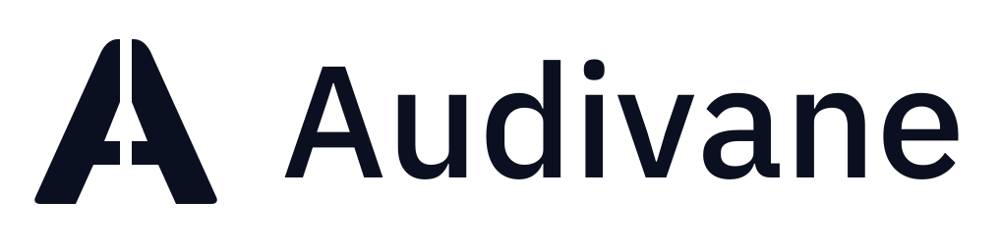
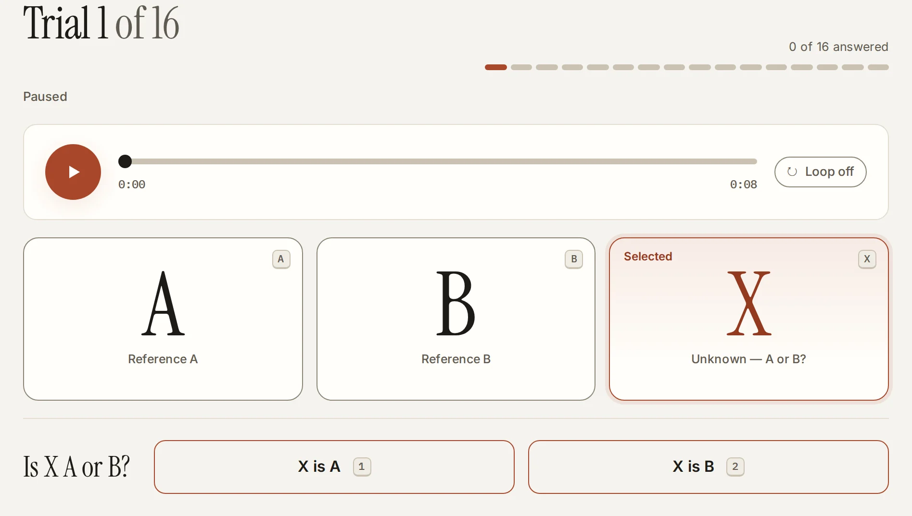
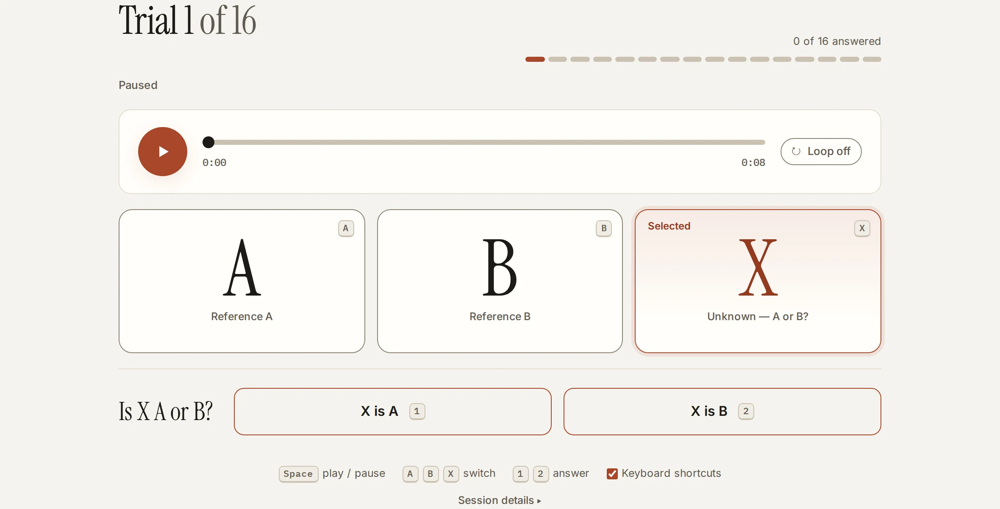

<p align="center">
  <picture>
    <source media="(prefers-color-scheme: dark)" srcset="assets/brand/audivane-logo-dark.svg">
    
  </picture>
</p>

<h3 align="center">ABX: blind audio comparisons</h3>

<p align="center">
  Can you really hear the difference between two codecs, bitrates or encoders?<br>
  Audivane ABX prepares both versions from your own file and tests you blind.
</p>

<p align="center">
  <a href="https://github.com/audivane/abx/releases/latest"></a>
  <a href="LICENSE"></a>
  
</p>

<p align="center">
  <a href="https://audivane.app/abx/"><b>Open Audivane ABX</b></a> ·
  <a href="https://github.com/audivane/abx/releases/latest">Releases</a> ·
  <a href="docs/README.md">Docs</a>
</p>

<p align="center">
  <picture>
    <source media="(prefers-color-scheme: dark)" srcset="docs/images/trial-dark.webp">
    
  </picture>
</p>

## Why

- **Your music, not test clips.** Import a local file and build two codec
  chains, Side A and Side B, from the same decoded source.
- **Fair by construction.** Both sides are aligned and loudness-matched, and
  the exact bytes you hear are verified before the first trial.
- **Properly blind.** Fixed-trial ABX with the answers hidden until the run
  ends, plus a binomial result that tells you whether you beat guessing.
- **Private.** Everything runs in your browser with WebAssembly codecs.
  Nothing is uploaded.
- **Auditable.** Results export with the full preparation record, so anyone
  can check what was compared.

## Use it

Open <https://audivane.app/abx/> in a current desktop browser. There is
nothing to install. The app needs an internet connection on first load for the
codec modules, then works from the browser cache.

The **desktop app is archived**. Its 1.0.0 downloads stay on
[GitHub Releases](https://github.com/audivane/abx/releases), unsigned and
unsupported; the source is kept at the `desktop-final` tag. Version 1.1.0 and
later are browser-only.

## How a test works



1. **Setup**: import a track and pick the codec and bitrate for each side.
2. **Prepare**: Audivane encodes both sides, aligns and level-matches them,
   and verifies the result.
3. **Listen**: play A, B and X as often as you like, then answer
   *X is A* or *X is B*. Keys: <kbd>Space</kbd>, <kbd>A</kbd> <kbd>B</kbd> <kbd>X</kbd>, <kbd>1</kbd> <kbd>2</kbd>.
4. **Results**: score, p-value and the complete record, ready to export.

<br clear="right">

## What it supports

| | |
| --- | --- |
| **Input** | WAV, FLAC, MP3, M4A/MP4, AAC (ADTS), Ogg/Opus (up to 30 min / 512 MiB, mono or stereo) |
| **Codecs** | MP3, AAC, Opus, Vorbis, MP2, SBC, aptX, aptX HD, LC3, LDAC |
| **Rates** | 44.1, 48 and 96 kHz kept as-is; other rates converted to 48 kHz |
| **Playback** | Verified PCM16 WAV for both sides |
| **Themes** | System, Light, Graphite, Midnight |

Exact limits are in [audio import](docs/audio-import.md); the statistics and
alignment rules are in [methodology](docs/methodology.md). A passing test
shows what *you* heard on *your* setup; it is not a codec conformance test.

## Build from source

Node 24 (or ≥ 22.12):

```sh
git clone https://github.com/audivane/abx.git && cd abx
npm ci
npm run dev        # http://127.0.0.1:5173
```

Build the optional LC3 and LDAC modules with `tools/build_codec_wasm.sh`
before starting the client if you need all eleven codecs. The production site
bundle and the checks are described in [development](docs/development.md).

## Contributing

Bug reports and pull requests are welcome. Please read
[CONTRIBUTING.md](CONTRIBUTING.md) first: pull requests need a one-time
[Contributor License Agreement](CLA.md), which a bot will ask you to sign.

## License

Copyright © 2026 Triet ([@Triet1402](https://github.com/Triet1402)).
Audivane ABX is free software under the
[GNU Affero General Public License v3.0 only](LICENSE).
Bundled codecs, fonts and libraries keep their own licenses; see
[third-party notices](THIRD_PARTY_NOTICES.md) and
[browser materials](docs/browser-materials.md).
